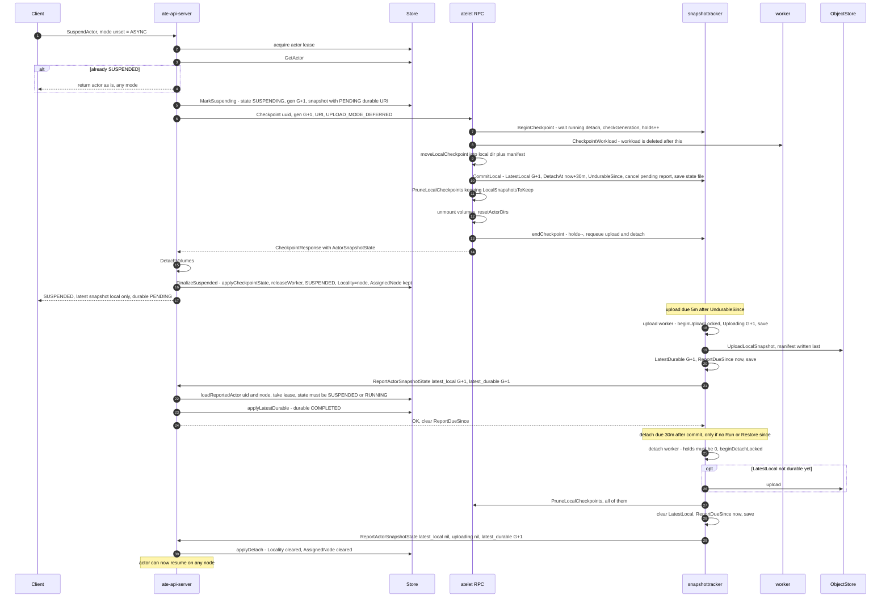
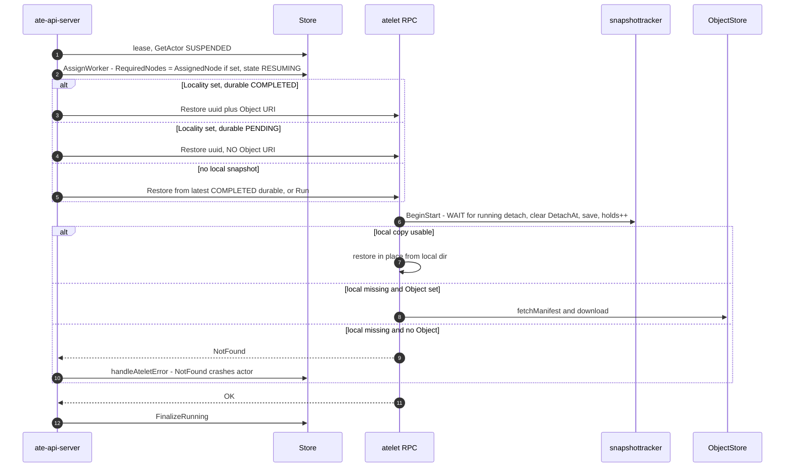
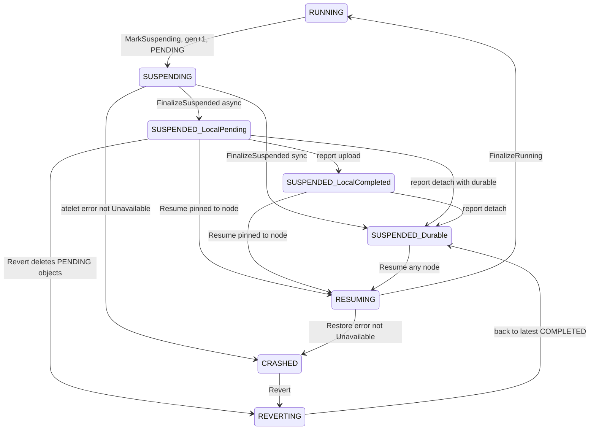

# Async Suspend / Upload / Detach：sequence、并发模型、edge case 与测试矩阵

> [!NOTE]
> 结论全部来自 `main@d2b97509` 的代码（不是 docs）。标注 **[已确认]** 的结论有代码路径为证；标注 **[需验证]** 的结论依赖某个外部组件的行为（例如 worker 对缺失 workload 返回什么 code），必须先写一个红灯测试确认。
> RPC 的真实名字是 `WorkerService.ReportActorSnapshotState`（不是 `...Status`）。

---

## 0. 先回答：从哪里入手？

推荐的顺序，每一步都是下一步的输入：

1. **Sequence diagram + 状态模型**（本文 §1–§2）：把"谁持有什么 state、谁在什么时候写"讲清楚。
2. **Invariants（判定标准/oracle）**（§5）：把"不该 crash"和"必须 crash"写成可以机器检查的断言。没有 oracle，测试矩阵再大也只能断言"没 panic"。
3. **Crash classification table test**（§4）：成本最低、收益最高。现在 ateapi 默认"除 Unavailable/Canceled/DeadlineExceeded 以外全部 crash"，很多不必要的 crash 都出在这里。
4. **Two-sided harness**（§6.3）：真实的 `snapshottracker` + 真实的 `controlapi` workflow，用 gate 控制 interleaving。目前缺这一层，所有跨组件的 race（§3 的 A3/A4/C1/C3）都只能靠它测。
5. **Model-based 随机测试**（§6.4）：建立在 4 之上，用随机操作序列 + invariant 覆盖你想不到的组合。

不建议一开始就做随机测试或 e2e：没有 oracle 和可控的 harness，失败无法复现，也无法定位。

---

## 1. Sequence diagrams

### 1.1 Async suspend → background upload → background detach（happy path）

关键代码：
- ateapi：[SuspendActor](../../cmd/ateapi/internal/controlapi/workflow_suspend.go#L74-L135)、[ensureMarkedSuspending](../../cmd/ateapi/internal/controlapi/workflow_suspend.go#L159-L208)、[ensureAteletSuspended](../../cmd/ateapi/internal/controlapi/workflow_suspend.go#L220-L273)、[ensureSuspendedFinalized](../../cmd/ateapi/internal/controlapi/workflow_suspend.go#L317-L424)
- atelet：[Checkpoint](../../cmd/atelet/main.go#L853-L1038)、[CommitLocal](../../cmd/atelet/internal/snapshottracker/lifecycle.go#L35-L65)、[backgroundUpload](../../cmd/atelet/internal/snapshottracker/upload.go#L85-L134)、[finishDetach](../../cmd/atelet/internal/snapshottracker/detach.go#L102-L165)、[report](../../cmd/atelet/internal/snapshottracker/report.go#L188-L233)
- report 处理：[ApplyReportedSnapshotState](../../cmd/ateapi/internal/controlapi/snapshot_report.go#L43-L90)、[applyLatestDurable](../../cmd/ateapi/internal/controlapi/snapshot_report.go#L174-L213)、[applyDetach](../../cmd/ateapi/internal/controlapi/snapshot_report.go#L221-L237)

### 1.2 Resume：三条路径 + 一个 race

Race（§3 A3）：如果 background detach 在 ateapi 读到 `PENDING` 之后、Restore 的 `BeginStart` 之前删除了本地文件，Restore 会走 `NotFound` 分支，actor 被 crash。但 durable 那份其实已经在 object storage 里了。

关键代码：[schedulingConstraints RequiredNodes](../../cmd/ateapi/internal/controlapi/workflow_resume.go#L655-L662)、[只在 COMPLETED 时才带 Object](../../cmd/ateapi/internal/controlapi/workflow_resume.go#L847-L851)、[atelet Restore local/fallback](../../cmd/atelet/main.go#L1442-L1469)、[BeginStart](../../cmd/atelet/internal/snapshottracker/lifecycle.go#L168-L193)

---

## 2. 状态模型

### 2.1 ateapi 侧：一个 async-suspended actor 的形态

| 形态 | `snapshots[latest].Locality` | `durable.Status` | `AssignedNode` | 可在哪 resume |
|---|---|---|---|---|
| LocalPending | node | PENDING | node | 只能 node |
| LocalCompleted | node | COMPLETED | node | 只能 node（local 不可用时会 fallback 下载） |
| Durable | "" | COMPLETED | "" | 任意 node |

Report 被接受的前提：actor 是 `SUSPENDED` 或 `RUNNING`（[switch](../../cmd/ateapi/internal/controlapi/snapshot_report.go#L62-L71)），UID 匹配，并且 caller node 是 `AssignedNode` 或者某个 snapshot 的 `Locality`。

### 2.2 atelet 侧：tracker 的 per-actor 状态

持久化（state file）：`LatestLocal`、`Uploading`、`LatestDurable`、`UndurableSince`、`DetachAt`、`ReportDueSince`。
只在内存里：`op`（upload|detach，最多一个）、`holds`（Run/Restore/Checkpoint/Promote 计数）、`inFlight`、`promotes`、`retryAt`、`uploadingFailed`、`unsaved`。
见 [actorSnapshotsRecord](../../cmd/atelet/internal/snapshottracker/actor.go#L122-L221)。

时间参数（[background.go](../../cmd/atelet/internal/snapshottracker/background.go#L30-L48)、[report.go](../../cmd/atelet/internal/snapshottracker/report.go#L35-L57)）：upload delay 5m、detach delay 30m、失败 backoff 1m→10m、report 重试 5s→5m、**report 10 分钟后放弃**。

---

## 3. 并发模型

### 3.1 什么在串行化什么

| 层 | 机制 | 范围 | 漏洞 |
|---|---|---|---|
| ateapi | per-actor lease（[acquireLease](../../cmd/ateapi/internal/controlapi/workflow.go#L228-L238)），冲突时立即 `Aborted` | Suspend / Resume / Revert / Delete / **Report** 互斥 | lease lapse 之后旧 workflow 发出的 atelet RPC 仍可能在跑 |
| ateapi | `store.PreconditionFrom` 乐观并发 | 每次 `UpdateActor` | 冲突后 `Aborted`，交给 client 重试 |
| atelet | per-actor lock（只在 begin/end 时持有） | tracker 的所有状态 | — |
| atelet | `op`：每个 actor 最多一个 upload 或 detach | upload 和 detach 互斥 | — |
| atelet | `holds` | Run/Restore/Checkpoint/Promote 进行期间不 detach、不 report | upload **不受** holds 限制（Promote 例外） |
| atelet | `checkGeneration` + `inFlight` | 拒绝更老的 generation | 同 uuid 的重复 Checkpoint **会被放行** |

### 3.2 atelet per-actor interaction matrix（行：正在进行；列：新到达）

| 进行中 \ 到达 | Checkpoint | Restore/Run | Promote | bg upload | bg detach | Report | Terminate(Forget) |
|---|---|---|---|---|---|---|---|
| **Checkpoint** | 同 gen 同 uuid：并发放行 ⚠️；更老 gen：`FailedPrecondition` | 都 hold，没有互斥 ⚠️ | 并发 | 照常运行 | 等 hold 结束 | 推迟 | 不等待，直接 drop entry |
| **Restore/Run** | 并发 | 并发 | 并发 | 照常运行 | 等待 | 推迟 | 不等待 |
| **bg upload** | 不等待 upload；prune 保留 `Uploading` | 不等待 | 同一 snapshot 时等待 | 一次只有一个 op | 等 op 结束 | 允许 | cancel op |
| **bg detach** | **等待** | **等待**，之后本地文件已删 ⚠️ | 等待 | 等 op 结束 | — | 允许 | cancel op（prune 可能做到一半） |
| **Report in flight** | commit 会 cancel 掉 pending report | — | — | 新变化会触发再次 report | 同左 | 一个 worker | `endReport` 看到 entry 不存在 |

⚠️ 标的格子都在 §4 中有对应条目。

### 3.3 ateapi 跨 actor 操作的组合

- Suspend ↔ Report、Resume ↔ Report、Revert ↔ Report：靠 lease 串行。代价是**双向 `Aborted`**：report 拿着 lease 时，用户的 Resume 会失败（C1）；workflow 拿着 lease 时，report 失败并重试，最终可能放弃（A4）。
- Suspend ↔ Suspend、Suspend ↔ Resume：靠 lease + 状态前置条件。lease lapse 时有窗口（C3）。
- 快速 suspend/resume 循环：ateapi 的 gen 单调递增，`LastAssignedGeneration` 在 revert 之后也不减小。atelet 侧上传哪一份由 `UndurableSince` 锚定，被 supersede 的 snapshot 不会上传，正在进行的 upload 会越过新 commit 继续跑完。设计上没问题，已有测试覆盖（§7）。

---

## 4. Edge case 目录

图例：**期望** = 我认为正确的行为（需要团队确认）；**层** = 最适合放测试的层（U=单元，H=two-sided harness，M=model-based，E=e2e）。

### A. 不必要的 crash（数据其实完好）

| ID | 场景 | 当前结果 | 证据 | 期望 | 层 |
|---|---|---|---|---|---|
| **A1** | **Checkpoint 在已经 commit 之后被重试**。触发条件：response 丢失（Unavailable/DeadlineExceeded）、ateapi 在 Checkpoint 和 FinalizeSuspended 之间重启或 lease lapse、Finalize 时 version conflict（`Aborted`）。重试会以 SUSPENDING 重新进入 → 再发一次 Checkpoint。atelet 的 `BeginCheckpoint` 放行同 uuid，然后对一个已经没有 workload 的 worker 调 `CheckpointWorkload` | worker 报错，只要不是 Unavailable → **CRASHED**；但 DEFERRED 下 `LatestLocal==uuid`、IMMEDIATE 下 `LatestDurable==uuid`，snapshot 是完好的 | [已确认] atelet 侧：[Checkpoint 调用 worker 前没有幂等检查](../../cmd/atelet/main.go#L895-L950)；ateapi 自己的注释承认了这个 [reentrancy seam](../../cmd/ateapi/internal/controlapi/workflow_suspend.go#L215-L219)。[需验证] worker 对缺失 workload 返回的具体 code | atelet 发现 tracker 已经 commit 了这个 uuid（local 或 durable）时直接返回 state，不调用 worker | U（atelet lifecycle_test）+ H |
| **A2** | **atelet 以 stale generation 拒绝 Checkpoint**（`BeginCheckpoint` 返回 `FailedPrecondition`） | **CRASHED**。实际上 workload 根本没被碰过，还在跑 | [已确认] [checkGeneration](../../cmd/atelet/internal/snapshottracker/actor.go#L418-L431) → [ateletErrorCrashesActor 默认 crash](../../cmd/ateapi/internal/controlapi/crash.go#L62-L83) | 不 crash；workflow 以 FailedPrecondition/Aborted 失败，重新读取 actor | U（crash_test） |
| **A3** | **Resume 与 background detach 赛跑**：ateapi 读到 `PENDING`，所以 Restore 不带 Object；atelet 的 `BeginStart` 等 detach 跑完，而 detach 已经删掉了本地文件 | atelet `NotFound` → **CRASHED**；durable 那份其实已经在 object storage 里 | [已确认] [只在 COMPLETED 时才设置 Object](../../cmd/ateapi/internal/controlapi/workflow_resume.go#L849-L851)、[Restore NotFound](../../cmd/atelet/main.go#L1449-L1452)、代码里有 [TODO](../../cmd/atelet/internal/snapshottracker/detach.go#L129-L130) | 最简单的修法：ateapi **总是**带上已记录的 URI（PENDING 也带），atelet 本地缺失时去 probe manifest。manifest-last 保证这样做是安全的，[uploadLocalCheckpointDir](../../cmd/atelet/main.go#L1239-L1253) 已经在用同样的逻辑。只有 manifest 也不存在时才 `NotFound` → crash（这时是真的数据丢失） | H |
| **A3'** | **A3 的连锁反应**：crash 之后用户执行 Revert → [ensureInProgressSnapshotDiscarded](../../cmd/ateapi/internal/controlapi/workflow_revert.go#L214-L258) 删除所有 PENDING 的 object | **删掉了唯一一份完好的 durable 副本** → 不必要的 crash 升级成真正的数据丢失 | [已确认] 组合推导 | 修好 A3/A4 就能避免；也可以考虑让 revert 删除前先 probe manifest | H |
| **A4** | **Report 放弃**：ateapi 不可用超过 10 分钟，或者 actor 长时间处于 transitioning（Aborted），之后 detach 的 report 也放弃 | ateapi 停留在 PENDING + Locality=N，atelet 本地已经清空 → Resume 时 `NotFound` → **CRASHED**；在此之前 actor 一直被 pin 在 N 上 | [已确认] [give up](../../cmd/atelet/internal/snapshottracker/report.go#L303-L308)；放弃后 `ReportDueSince` 被清零，不会再发 | A3 的修法同样覆盖这个场景；另外可以考虑：放弃之后在下一次 state 变化或启动时重新上报（因为 state 本身是幂等的） | U + H |
| **A5** | **Checkpoint 在 CommitLocal 之后的 cleanup 失败**（`unmountExternalVolumes`、`resetActorDirs`） | 返回 Unknown → **CRASHED**；snapshot 已经 commit。代码注释写着 "we do not crash the actor if resetting the directory fails"，与实际行为相反 | [已确认] [main.go L1025-L1034](../../cmd/atelet/main.go#L1025-L1034) | 返回成功并附带 state，cleanup 交给后续流程；或者返回一个明确不触发 crash 的 code | U |
| **A6** | **Restore 前置步骤失败**（`resetActorDirs`、`resetSandboxAssetsDir` 等 node 本地问题） | `fmt.Errorf` → Unknown → **CRASHED**。代码注释写着 "Not crashing the actor ..."，与实际行为相反 | [已确认] [main.go L1397-L1408](../../cmd/atelet/main.go#L1397-L1408) | 映射为 Unavailable，或用 §4.1 的显式分类 | U |
| **A7** | **以后接入 DetachActor / PromoteSnapshot**（[TODO #2734](../../cmd/ateapi/internal/controlapi/workflow_suspend.go#L121)、resume 到其他 node 的 TODO） | atelet 会返回 `Aborted`（in use）、`FailedPrecondition`（无 object）、`Unimplemented`（版本 skew），按现有策略**全部 crash** | [已确认] [Detach](../../cmd/atelet/internal/snapshottracker/detach.go#L47-L85)、[proto 注明 UNIMPLEMENTED](../../internal/proto/ateletpb/atelet.proto#L344-L357) | 接入之前先把分类表定好 | U |

### B. 数据丢失了，但没有 crash / 没有暴露出来

| ID | 场景 | 当前结果 | 证据 | 期望 | 层 |
|---|---|---|---|---|---|
| **B1** | **Node 丢失**（VM 被删、被抢占、磁盘被清），而 actor 是 SUSPENDED 且最新 snapshot 只在本地 | 没有任何组件处理：worker-delete 路径[跳过 SUSPENDED](../../cmd/ateapi/internal/controlapi/workflow_worker_delete.go)，ateapi 里没有 node watcher。Resume 因 `RequiredNodes=[dead]` 永远 `ResourceExhausted`；**Revert/Delete 也卡死**：`AssignedNode != ""` 时会去 dial atelet，拿到 [ErrNoAteletOnNode](../../cmd/ateapi/internal/controlapi/dialer.go#L127-L129)，而这个错误在任何地方都没有被处理 | [已确认] | node 确认消失时：最新 snapshot 是 COMPLETED → 清除 Locality/AssignedNode，**不 crash**；否则 → **CRASH**（数据丢失，可以 revert 到最近的 COMPLETED）。注意要区分 "atelet pod 短暂重启" 和 "node 真的没了" | H + E |
| **B2** | **本地 snapshot 损坏或丢失，而且还没上传** | background upload 永远失败（"local snapshot gone and no uploaded copy"），backoff 最多 10m，无限重试；detach 同样无限失败；**从不上报**。ateapi 直到 Resume 才发现（`NotFound` → crash，这一步是正确的） | [已确认] [uploadLocalCheckpointDir](../../cmd/atelet/main.go#L1239-L1253)、[backgroundUpload default 分支](../../cmd/atelet/internal/snapshottracker/upload.go#L117-L129) | atelet 把它分类为永久失败并上报（例如在 state 里加一个 lost 标记），ateapi 主动 crash；至少要有 metric/alert | U + H |
| **B3** | **atelet state file 写失败或不可读** → atelet 重启后 tracker 不再知道 `LatestLocal` | 不会上传，也不会 detach，本地文件留着，actor 被永久 pin，durability 永远达不到。之后一旦 node 丢失就是 B1 | [已确认] [saveLocked best-effort](../../cmd/atelet/internal/snapshottracker/state.go#L34-L38)、[readSnapshotState 跳过](../../cmd/atelet/internal/snapshottracker/state.go#L62-L76) | 启动时用本地目录对账（目录里有 snapshot 但 state 里没有 → 报警，或者重建 state） | U |
| **B4** | **IMMEDIATE（sync）上传失败** | crash（[TODO #362](../../cmd/atelet/main.go#L977-L986)）。workload 已经删除且没有本地缓存，所以**按现状 crash 是正确的** | [已确认] | 可以优化：先 move 到本地，再降级为 DEFERRED，而不是 crash | U |
| **B5** | **atelet 在 `CheckpointWorkload` 之后、`CommitLocal` 之前重启** | 文件留在 checkpointDir 但没有被记录；重试走到 A1 → crash。数据实际上算是丢了（没有记录），crash 可以接受 | [已确认] 推导 | 记录为已知限制 | H |

### C. 并发 / liveness / 用户可见的问题（不一定 crash）

| ID | 场景 | 当前结果 | 期望 / 要测什么 | 层 |
|---|---|---|---|---|
| **C1** | Report 拿着 actor lease 时，用户调用 Suspend/Resume/Revert | 用户收到 `Aborted: another operation is in progress` | 确认 client（router、kubectl、SDK）都会重试；或者让 report 用 try-lock 短时间持有，冲突时自己退让 | H |
| **C2** | Report 碰到 SUSPENDING/RESUMING/REVERTING/DELETING | `Aborted`，atelet 退避重试，10 分钟后放弃（→ A4） | 测 give-up 边界，以及"放弃之后的下一次 state 变化"能否重新上报 | U |
| **C3** | **Lease lapse**：旧 workflow 的 Checkpoint 还在 atelet 里跑，新 workflow 重新进入 SUSPENDING，对**同一个 uuid** 再发一次 Checkpoint | atelet 放行（同 uuid），两次 `CheckpointWorkload` 并发 → 至少一次失败；新 workflow 看到的错误会导致 crash（旧 workflow 的 ctx 已经取消，不会 crash） | atelet 对同一 actor 的 Checkpoint 做串行化或去重（与 A1 一起修） | H |
| **C4** | Restore 被 detach 中的 upload 阻塞（`BeginStart` 等 detach） | 可能等很久 → ateapi `DeadlineExceeded`，不 crash，但重试会继续排在后面；等到之后又会进入 A3 | 测 latency 上界；考虑让 Restore 抢占或取消 detach | H |
| **C5** | Paused actor 在 upload 进行中被 Revert | Terminate→Forget cancel upload，revert 删除 PENDING prefix。如果 plugin 不响应 cancel，会在删除之后继续写 → **orphan objects**（泄漏）。revert 的结果取决于 upload report 有没有先落地（[已有测试](../../cmd/ateapi/internal/controlapi/workflow_revert_test.go)只覆盖了"已上传"这一种情况） | 测 cancel 是否传到 plugin；revert 结果的不确定性需要在 API 语义上明确 | H |
| **C6** | 对一个 paused（SUSPENDED、local-only）的 actor 调 `SuspendActor(SYNCHRONOUS)` | [原样返回](../../cmd/ateapi/internal/controlapi/workflow_suspend.go#L109-L111)，调用方以为已经 durable，实际上没有 | API 语义需要决定：等待 upload，或主动 promote | U |
| **C7** | 在 upload 被记录之前对 paused actor 打 Tag | `FailedPrecondition`（[TODO](../../cmd/ateapi/internal/controlapi/workflow_tag.go#L218-L231)），最长持续 5 分钟 + report 延迟 | 同 C6 | U |
| **C8** | 快速 suspend/resume 循环 | 设计上已经处理（`UndurableSince` 锚定、superseded 不上传、prune 保留 `Uploading`、迟到的旧 gen report 被忽略）。被 supersede 的 PENDING object 会一直留到 actor 删除 | 保持现有回归测试；在 model-based 测试里做高频循环 | M |
| **C9** | 同一个 uuid 正被 Restore 读（`PreserveRestoreDir`）的同时又被 upload 读 | 只读，安全。前提是 microVM 的 `MergeDeltaIntoBase` 遇到 preserved/Nlink>1 时不走 in-place（[merge.go](../../cmd/ateworker-microvm/internal/ch/merge.go#L132-L137)） | 加一条 invariant："被 upload 读的 local dir 不能被修改"（对文件做 hash 断言） | U |

### D. 设计上正确、已有测试的（保持回归即可）

- 迟到的旧 report、旧 incarnation 的 report、来自其他 node 的 report：返回 `NotFound`/被忽略，**不会 crash**（`TestApplyReportedSnapshotState`、`TestApplyLatestDurableLogsStaleReports`、`TestActorOnNode`）。你提到的"out-of-date report 不应该 crash actor"，现在的代码确实不会 crash。真正的风险在反方向：**report 丢失**（A4）。
- CRASHED actor 收到 report：`FailedPrecondition`，atelet 丢弃这个 report。
- Checkpoint 期间 upload 照常跑、prune 保留 `Uploading`（`TestTrackerCheckpointDuringUpload`、`TestCheckpointKeepsSnapshotBeingUploaded`）。
- atelet 重启时 upload/report/detach 的恢复（`TestTrackerResumesUploadAfterRestart`、`TestTrackerReportsAfterRestart`、`TestTrackerDetachRetriesFailedPrune`）。
- Restore 之后不再 detach（`TestRestoredActorIsNotDetached`、`TestFailedRestoreUnschedulesDetach`）。
- 拒绝 stale gen（`TestCheckpointRejectsStaleGeneration`、`TestCheckpointInFlightRejectsOlderGeneration`）。注意：这些测试只验证 atelet 会拒绝，没有验证 ateapi 收到之后**不该 crash**（A2）。

### 4.1 Crash classification：现状 vs 建议

现状（[ateletErrorCrashesActor](../../cmd/ateapi/internal/controlapi/crash.go#L62-L83)）：除了 `Unavailable`/`Canceled`/`DeadlineExceeded`、ctx 已结束、Terminate 这几种情况，**其余全部 crash**。这相当于"默认 crash"。

| RPC | atelet 可能返回 | 数据是否丢失 | 现状 | 建议 |
|---|---|---|---|---|
| Checkpoint | `FailedPrecondition`（stale gen，worker 前） | 否，workload 还在跑 | crash | 不 crash（A2） |
| Checkpoint | worker 错误（worker 前已 commit 同 uuid） | 否 | crash | atelet 幂等（A1） |
| Checkpoint | worker 错误（首次） | **是**（workload 状态未知或已删除） | crash | crash ✅ |
| Checkpoint | `CommitLocal` 之后 cleanup 失败 | 否 | crash | 不 crash（A5） |
| Checkpoint IMMEDIATE | upload 失败 | **是** | crash | crash ✅（或者降级，B4） |
| Restore | `NotFound`，local 和 object 都不存在 | **是** | crash | crash ✅ |
| Restore | `NotFound`，但 durable 其实存在（A3/A4） | 否 | crash | 修请求，不要修分类 |
| Restore | node 本地 FS 错误 | 否 | crash | 不 crash（A6） |
| Restore | `Unavailable`（`BeginStart` 保存 state 失败） | 否 | 不 crash ✅ | — |
| DetachActor / Promote（未来） | `Aborted` / `FailedPrecondition` / `Unimplemented` | 否 | 会 crash | 不 crash（A7） |

**结构性建议**：判断"数据有没有丢"的知识在 atelet 一侧（它知道 workload 有没有被删、snapshot 有没有 commit）。所以应该由 atelet 用 `ErrorInfo` reason（例如 `ACTOR_STATE_LOST`）**显式**声明数据丢失，ateapi 只在看到这个 reason 时才 crash。atelet 代码里已经有同方向的 [TODO "should-crash" metadata](../../cmd/atelet/main.go#L947-L949)。代价是要逐个审 atelet 的每条错误路径；好处是 A2、A5、A6、A7 一次全部解决，而且以后新加的错误码默认不会 crash。这个取舍需要团队决定：现在的"默认 crash"是 fail-safe 的，改成"默认不 crash"以后，漏标的路径会变成 actor 卡在 SUSPENDING/RESUMING，而不是 CRASHED。

---

## 5. Invariants（测试的 oracle）

每个 H/M 测试的每一步之后都检查这些 invariant。

| ID | Invariant | 违反时说明什么 |
|---|---|---|
| **I1 No silent loss** | 如果 ateapi 记录的最新 snapshot 不是 COMPLETED，那么 `Locality=N`、`AssignedNode=N`，并且 N 上的 atelet 磁盘里确实有这份 snapshot | B1/B2/B3 |
| **I2 No unnecessary crash** | actor 变成 CRASHED 时，必须同时满足下面两条：(a) 本地和 object storage 里都**找不到**最新记录的 snapshot；(b) workload 状态未知（RUNNING/SUSPENDING 时 worker 死了，或者 Checkpoint 首次失败） | A1–A7 |
| **I3 Restore resolvable** | ateapi 每次向 node N 发 Restore(uuid) 时，要么 N 本地有可用的 uuid，要么请求带了 Object 并且 manifest 存在 | A3/A4 |
| **I4 Delete-after-durable** | atelet 删除 `LatestLocal` 之前，`LatestDurable.gen >= LatestLocal.gen` 已经落盘 | detach 顺序 |
| **I5 Gen monotonic** | atelet commit 的 gen 永不回退；ateapi 的 `LastAssignedGeneration` 永不回退 | — |
| **I6 Pin consistency** | SUSPENDED 时：`AssignedNode != ""` ⇔ 存在 `Locality == AssignedNode` 的 snapshot | applyDetach |
| **I7 Convergence (liveness)** | 故障停止后经过 `uploadDelay + detachDelay + report backoff` 这段时间，ateapi 的状态与 atelet 的 state 一致 | A4/B3 |
| **I8 Revert safety** | revert 只删除 manifest 确实不存在的 object，或者确实已被更新的 COMPLETED snapshot supersede 的 object | A3' |

---

## 6. 测试策略

### 6.1 测试矩阵怎么做到尽量完整

把矩阵拆成三个正交维度，然后系统地组合：

1. **Operations（O）**：SuspendAsync、SuspendSync、Resume、Revert、Delete、Tag、BgUpload、BgDetach、Report、AteletRestart、AteapiRestart/LeaseLapse、NodeLoss、AteletTerminate。
2. **Injection points（P）**：每个操作里**每一次持久化写入**和**每一次 RPC** 的前后各算一个点。例如 Suspend：MarkSuspending 写之后 / Checkpoint 请求发出后 / atelet CommitLocal 之后 / response 返回前 / Finalize 写之前。atelet：`beginUploadLocked` save 之后、upload 完成之后 `endOpLocked` 之前、prune 前、prune 中、`clearLatestLocal` save 之前、report 发出后响应前。
3. **Faults（F）**：RPC 返回各种 code（全部 17 个都要覆盖到分类表）、response 丢失（服务端成功、客户端看到 Unavailable）、超时、store version conflict、upload 瞬时失败 / 永久失败、state file 写失败、进程重启。

组合方式：
- **单故障穷举**：对每个 (O, P, F)，执行到 P 注入 F，然后让系统自行恢复（重试 / 时间推进），检查 I1–I8。这一层可以用 table 生成，规模在几百个 case 以内。
- **Pairwise interleaving**：对每个 (A 在 P 处暂停, B 完整执行一次)，然后恢复 A，再检查 invariant。§3.2 的矩阵就是这一层的骨架。
- **随机高阶组合**：交给 §6.4 的 model-based 测试。
- **Mutation 验证**（对应 AGENTS.md 里"prove the strict branch red"）：故意破坏一个 guard，例如去掉 `BeginStart` 里的 `waitForDetachLocked`、去掉 `checkGeneration`、让 `finishDetach` 先 prune 再记录 durable，确认至少有一个测试变红。如果没有变红，说明矩阵有洞。

### 6.2 各层测试放在哪里

| 层 | 位置 | 已有 | 要补的 |
|---|---|---|---|
| tracker 单元 | `cmd/atelet/internal/snapshottracker/*_test.go`（有 synctest、fake Store） | 覆盖很全，约 100 个测试 | B2（永久失败的分类/上报）、B3（启动对账）、A4（放弃后再次上报） |
| atelet RPC | [cmd/atelet/lifecycle_test.go](../../cmd/atelet/lifecycle_test.go) | stale gen、本地优先、promote | **A1**（同一个 Checkpoint 请求发两次）、**C3**（两个同 uuid 的 Checkpoint 并发）、A5、A6 |
| ateapi 分类 | [crash_test.go TestHandleAteletError](../../cmd/ateapi/internal/controlapi/crash_test.go#L358) | 按 code 测 | 扩展成 (RPC × code × phase) → 期望 crash/不 crash，直接对照 §4.1 |
| ateapi report | `snapshot_report_test.go` | actor state × report 形状 | 补齐 gen 关系 × Locality × state 的组合 |
| ateapi workflow | `workflow_*_test.go`、`functionaltest/`（fakeAtelet） | 单侧 | Finalize conflict 之后的重试（配合 A1） |
| **two-sided** | **新增** | 无 | 见 §6.3 |
| e2e | `internal/e2e` | demo | 只做少量 smoke：杀 atelet / 卡住 object store / 删 node（B1） |

### 6.3 Two-sided harness（最值得投入的新东西）

- 真实的 `Atelet` gRPC server（真实 `snapshottracker`、fake worker、fake object-store plugin，`ateletpath` 指向 tmpdir），加上真实的 `controlapi.ActorWorkflow`（in-memory store），通过 `bufconn` 连起来；`WorkerService.ReportActorSnapshotState` 回接到同一个 workflow。
- 时间用 `testing/synctest`（tracker 已经用 `clock.WithTicker`，`report`/`upload`/`detach` 的 timer 都会走它）。
- **Gate**：在 fake Store/plugin/worker 以及 tracker 的少数几个 hook 点放 `chan struct{}`。最少需要这几个：upload 完成前、prune 前、report 发送前、`BeginStart` 进入前、`CheckpointWorkload` 返回前。可以通过 option 注入 test-only hook，或者直接用 fake 依赖阻塞来实现。
- 每个场景的写法：`script := []step{...}`，每一步之后 `checkInvariants(t, apiStore, ateletDir, objectStore)`。
- 第一批要写的场景（都应该**先红**）：A1、A2、A3（以及 A3' 的 revert 连锁）、A4、C1、C3、C5。

### 6.4 Model-based 随机测试

- 在 harness 上面，按 seed 生成长度 20–50 的随机操作序列。操作取自 O，故障取自 F，再加上 `advance(clock, d)`。
- 每一步之后检查 I1–I8；失败时打印 seed 和操作序列，并自动 shrink（删掉不影响失败的步骤）。
- 可以先作为 `-short` 跳过的长测试跑，稳定之后再进 CI。

---

## 7. 建议的第一批 PR（按 ROI 排序）

1. **A2 + A5 + A6 + 分类表测试**：只改 `crash.go`，以及 atelet 少数几处错误码；一个 table test 就能覆盖。
2. **A1/C3：atelet Checkpoint 幂等 + 串行化**：在 `BeginCheckpoint` 里，如果 tracker 已经有同 uuid 的 commit，就返回 state 并跳过 worker；同一 actor 的 Checkpoint 串行执行。测试放在 lifecycle_test。
3. **A3/A4：Restore 总是带上已记录的 URI**：改 ateapi 一行 + atelet 的 fallback 逻辑；需要 two-sided harness 来证明 race 已经修好。
4. **Two-sided harness**：可以和 3 一起做。
5. **B1 node loss**：需要设计（node 消失的判定、和 atelet pod 短暂重启区分、Revert/Delete 在 node 消失时跳过 Terminate），单独写 doc。
6. **B2/B3**：atelet 永久失败的上报和启动对账，需要先决定 API 形状（state 里加 lost 标记？）。

## 8. 需要你/团队决定的问题

1. **Crash 策略的默认值**：保留"默认 crash"，逐个加白名单；还是改成"atelet 显式声明数据丢失才 crash"（§4.1）？
2. **C6**：对 paused actor 调 `SuspendActor(SYNCHRONOUS)`，是否应该等 upload 完成或主动 promote，而不是原样返回？
3. **B1**：node 丢失时，最新 snapshot 不是 COMPLETED 的情况下，是 crash，还是自动回退到最近的 COMPLETED（等同隐式 revert）？
4. **A4**：report 放弃之后要不要恢复上报（例如下一次 state 变化或启动时重新上报完整 state）？
