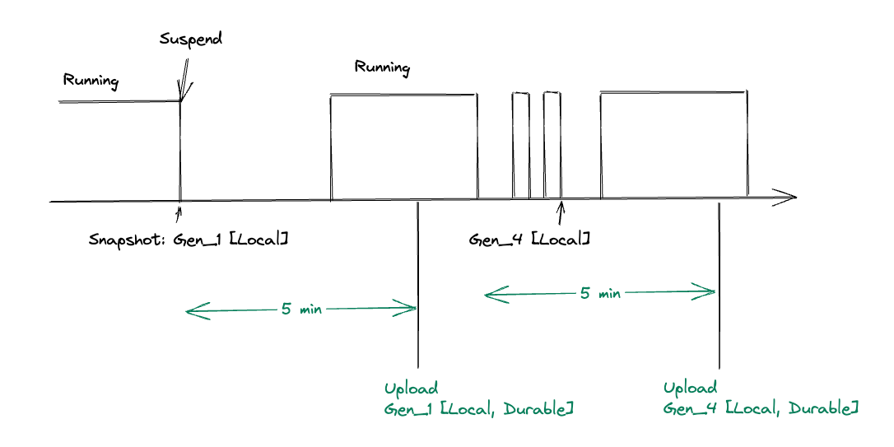
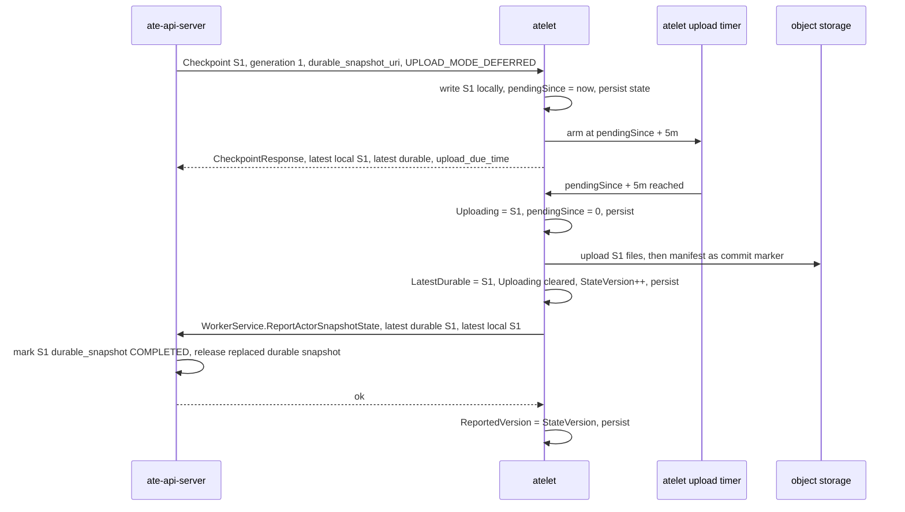
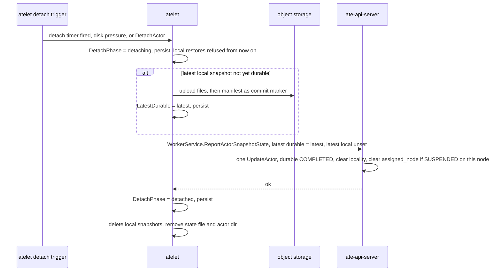
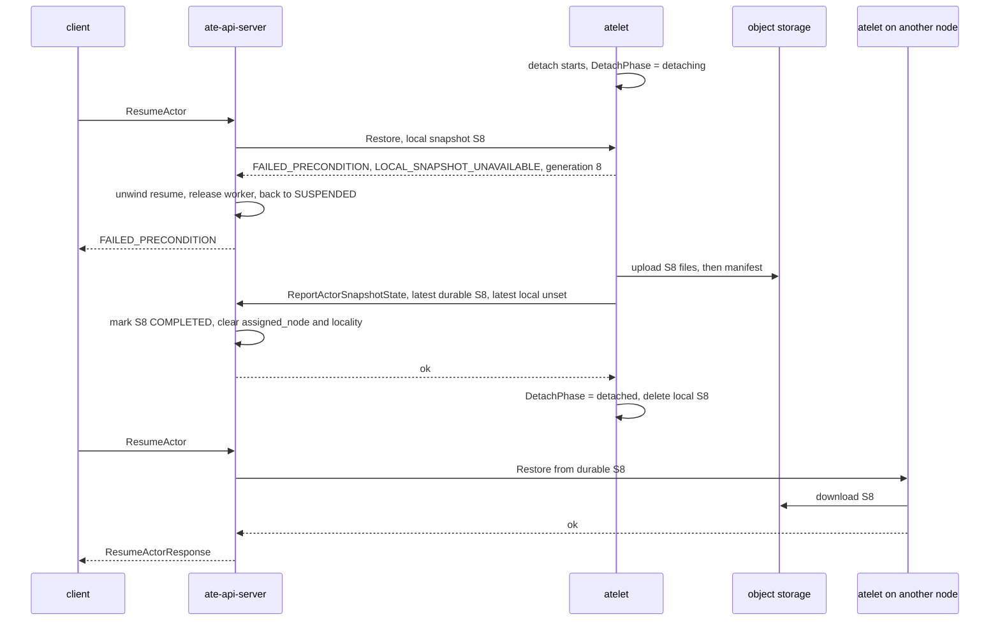

## Summary

Describes how atelet decides when to promote a snapshot to durable, local + durable, and durable only, and all the API protos associated with it.

### Example

`uploadDelay` = 5m, `detachDelay` = 30m.

| Minute | Event | atelet |
|---|---|---|
| 0 | Suspend → S1 | `pendingSince`=0, upload due 5, detach due 30 |
| 1 | Resume from S1 | Cancel detach. Upload still at 5 |
| 5 | Upload timer fires | Upload S1 while the actor runs, report to ate-api-server |
| 11 | Suspend → S2 | `pendingSince`=11, upload due 16, detach due 41 |
| 11–15.5 | Repeated resume/suspend → S3 … S8 | Each new snapshot prunes the previous one. `pendingSince` stays at 11. Each suspend resets detach |
| 16 | Upload timer fires | Upload S8. S2–S7 are never uploaded |
| 45.5 | Detach timer fires (suspended since 15.5) | S8 is already durable → `ReportActorSnapshotState` (latest local empty) is acked → delete local S8 |

### Full timeline

Only **what is uploaded, and when** (`uploadDelay` = 5m):



- Gen_1: on suspend, it is saved locally only. After 5 min it is uploaded. By then the actor has already resumed and is running, but the upload still goes ahead, and becomes `Gen_1 [Local, Durable]`.
- A later suspend produces Gen_2 and starts a new 5 min timer.
- Quick resume/suspend cycles during that timer produce Gen_3 and Gen_4, and do not push back the timer (`pendingSince` stays at the time since Gen_2 existed).
- When the 5 min are up, only the **latest** snapshot at that moment, Gen_4, is uploaded. Gen_2 and Gen_3 have already been pruned and are never uploaded.

## atelet behavior

### Key points

- **Only suspended actors are detached, never running actors.**
  - The detach timer is armed only while `Suspended`.
  - Disk pressure only picks suspended actors.
  - `DetachActor` returns `FailedPrecondition` for a running actor.
  - The local snapshot a running actor keeps after resuming from local is only freed when the actor next suspends and the new snapshot prunes it.
- A `Checkpoint` with `UPLOAD_MODE_IMMEDIATE` (golden actor) does not go through async upload.
  - It finishes the upload before returning and keeps no local snapshot, same as today's `CHECKPOINT_TYPE_EXTERNAL`.
- Reporting uploads to ate-api-server is retried in the background, without blocking the next upload.
  - Whether or not the report succeeds, every `CheckpointResponse` carries both the latest local and the latest durable snapshot, and `DetachActorResponse` carries the latest durable snapshot.

### Async upload flow

Uploads are driven by atelet's own timer. ate-api-server only provides `durable_snapshot_uri` on `Checkpoint`, and after that passively receives reports.



- The actor lock is not held for the whole upload. It is only held briefly for the state bookkeeping at the start and the end, so a new `Checkpoint` / `Restore` is not blocked during the upload.

Failure handling:

- **Upload fails: atelet retries asynchronously on its own with backoff until it succeeds.** It does not wait for a new snapshot, and it does not wait another 5 min.
  - **Retry interval**: exponential backoff (e.g. 10s, 20s, 40s…), capped at `uploadDelay`. No limit on the number of retries.
  - **When retries stop**: only in three cases: the upload succeeds, the actor is `Terminate`d, or detach takes over the upload.
  - **Each retry uploads the latest local snapshot at that moment**:
    - No new snapshot in the meantime → the retry uploads S1 again.
    - S2 arrives in the meantime → the next retry uploads S2 directly, and S1 is pruned and never uploaded.
  - **Re-upload from scratch**: object names are deterministic, so they can simply be overwritten. The manifest is written last, so an upload that did not finish writing its manifest does not count as durable.
  - **Setting `pendingSince` back to S1's time is only bookkeeping**, and does not make the next retry wait another 5 min:
    - The next retry time is `max(pendingSince + uploadDelay, retryNotBefore)`. S1's `pendingSince + uploadDelay` is long past, so in practice `retryNotBefore` (now + backoff) decides it.
    - Setting it back serves two purposes. First, it keeps invariant 2 (there is a snapshot that is not yet durable ⇔ `pendingSince` is non-zero). Second, after an atelet restart, `retryNotBefore` is not persisted, and the time computed from `pendingSince` has already passed, so the retry happens immediately.
  - Example: the first upload at t5 fails → the retry at t5+10s fails → the retry at t5+30s succeeds, and S1 is durable. If S2 arrives at t5+20s, the retry at t5+30s uploads S2 instead.
- Report fails: retried in the background with backoff, without blocking the next upload. Each retry sends the **current** full state, so if another upload happens in the meantime, the earlier one does not need to be resent. Every `CheckpointResponse` always carries both `local_snapshots` and `latest_durable_snapshot`, whether or not the report has succeeded.

### State notification: `WorkerService.ReportActorSnapshotState`

atelet uses **one** RPC to report to ate-api-server the snapshot state of an actor on its node: which snapshot is the latest durable one, and which local snapshot is the latest one usable for restore. Upload completion and detach are both just changes to this state.

- **One RPC for both upload and detach**: there is no separate upload-complete or detach RPC. An upload success changes `latest_durable`; a detach sets `latest_local` to empty. Both go through this same call.
- **It reports state, not events**: each call sends the current full `{latest_durable, latest_local}`. ate-api-server only needs to reconcile against the latest one, and lost or out-of-order older reports do not need to be resent.
- **When it is sent**:
  - After an upload succeeds (the manifest is written): `latest_durable` has changed.
  - On detach, after the latest snapshot is durable and before the local copy is deleted: `latest_local` becomes empty.
  - After an atelet restart, if there is state that has not been acked yet.
- **Not needed on Checkpoint**: `CheckpointResponse` already carries the same two fields.

#### API

```proto
service WorkerService {
  // ReportActorSnapshotState reports an Actor's snapshot state on the
  // caller's node: the newest snapshot atelet has uploaded, and the local
  // snapshot it will restore from, if any. Each report carries the whole
  // state, so a newer report supersedes any older one still in flight.
  //
  // The control plane marks latest_durable COMPLETED if it is newer than
  // what it has recorded. An unset latest_local means atelet no longer
  // serves local restores for the Actor (it is detaching or has detached):
  // the control plane clears Snapshot.locality for the caller's node and, if
  // the Actor is SUSPENDED there, status.assigned_node, so the next resume
  // may go to any node. atelet waits for this report to succeed before
  // deleting its local files. If retries keep failing past
  // detach_report_timeout, it deletes them anyway, provided the latest
  // snapshot's manifest is in object storage, and keeps reporting.
  //
  // atelet calls this with its own client certificate. Idempotent.
  rpc ReportActorSnapshotState(ReportActorSnapshotStateRequest) returns (ReportActorSnapshotStateResponse);
}

message ReportActorSnapshotStateRequest {
  // +k8s:required
  // +k8s:subfield(atespace)=+k8s:required
  ObjectRef actor = 1;

  // Pins the report to one incarnation of the Actor, as on
  // RequestActorSuspendRequest.
  //
  // +k8s:required
  // +k8s:format=k8s-uuid
  string actor_uid = 2;

  // The newest snapshot of the Actor atelet has uploaded. Unset if atelet has
  // uploaded none since the Actor arrived on this node.
  //
  // +k8s:optional
  DurableSnapshotInfo latest_durable = 3;

  // The local snapshot atelet will restore the Actor from. Unset once atelet
  // has started detaching the Actor, even while the files are still on disk:
  // from then on it refuses local restores.
  //
  // +k8s:optional
  LocalSnapshotInfo latest_local = 4;
}

message DurableSnapshotInfo {
  // Snapshot.uuid and Snapshot.generation as sent on the CheckpointRequest
  // that produced it.
  //
  // +k8s:required
  // +k8s:format=k8s-short-name
  string snapshot_uuid = 1;

  // +k8s:required
  // +k8s:minimum=1
  int32 generation = 2;

  // Where it was uploaded. Must equal the durable_snapshot_uri the control
  // plane sent on that CheckpointRequest: atelet cannot point a Snapshot at
  // objects of its choosing.
  //
  // +k8s:required
  // +k8s:maxLength=2048
  string snapshot_uri = 3;

  // When the manifest was written. Informational, for upload-lag metrics.
  //
  // +k8s:optional
  google.protobuf.Timestamp upload_complete_time = 4;
}

message LocalSnapshotInfo {
  // +k8s:required
  // +k8s:format=k8s-short-name
  string snapshot_uuid = 1;

  // +k8s:required
  // +k8s:minimum=1
  int32 generation = 2;
}

message ReportActorSnapshotStateResponse {}
```

#### ate-api-server handling steps

1. `GetActor`:
   - The actor does not exist, or `actor_uid` does not match → `NotFound`.
   - The actor is no longer on this node (`assigned_node` is not the caller, and no snapshot has the caller as its `locality`) → `NotFound`, so actors on other nodes are not exposed.
2. Validate `latest_durable` (if set):
   - `generation` ≤ the latest COMPLETED durable generation → this part is a no-op (duplicate or stale).
   - That generation is not found, or `uuid` does not match → `FailedPrecondition`.
   - `snapshot_uri` differs from the expected URI (the result of `newInProgressSnapshotURI` for that uuid) → `InvalidArgument`.
3. Validate the case where `latest_local` is empty (detach):
   - After applying step 2, the `durable_snapshot` of the latest generation on this node must be COMPLETED. Otherwise → `FailedPrecondition`: atelet wants to drop the only copy of the latest state, so it is rejected.
4. A single `UpdateActor` (optimistic precondition, without taking the actor lease, so it does not queue behind long workflows):
   - When `latest_durable` is updated: set that entry's `durable_snapshot = {COMPLETED, uri}`, and prune older durable entries.
   - When `latest_local` is empty: clear `Snapshot.locality` for this node on generations ≤ `latest_durable.generation`. If the actor is SUSPENDED on this node, also clear `assigned_node`. If it is RESUMING, only clear locality, since `assigned_node` is owned by the resume workflow. (atelet does not detach running actors.)
   - Version conflict → `Aborted`, and atelet retries.
5. After commit, release the replaced durable snapshot objects best-effort (same as today's `releaseReplacedSnapshot`).

#### How atelet handles the response

| Response | Meaning | atelet |
|---|---|---|
| OK | Recorded | `ReportedVersion = StateVersion`, persist. If this was a detach report, go on to delete the local copy |
| `NotFound` | Actor was deleted/recreated, or is no longer on this node | Stop reporting. The control plane no longer depends on this node's local copy, so it can be deleted |
| `FailedPrecondition` | The control plane no longer tracks that generation, or rejected the detach | Stop reporting, do **not** delete the local copy, emit an error log and metric |
| `InvalidArgument` | atelet bug | Same as above |
| `Aborted` / `Unavailable` / other | Transient error | Retry with backoff, each time sending the latest state at that moment, without blocking the next upload |

- After an atelet restart, if `ReportedVersion < StateVersion`, it keeps reporting.

#### Fallback when `ReportActorSnapshotState` keeps failing: `CheckpointResponse`

If `ReportActorSnapshotState` keeps failing (ate-api-server unreachable, persistent `Aborted`, etc.), the control plane must still be able to get the same state some other way. So:

- **Every `CheckpointResponse` must carry both the actor's local snapshots and the latest durable snapshot atelet has uploaded** (`local_snapshots`, `latest_durable_snapshot`), with exactly the same content as `ReportActorSnapshotState`. The highest generation in `local_snapshots` is the latest local snapshot.
  - They must be included whether or not the report has succeeded or is still retrying, and must not be omitted because "it was already reported".
  - `latest_durable_snapshot` is empty only if atelet has never uploaded a snapshot of that actor.
- **ate-api-server reconciles `CheckpointResponse` the same way as a report**: if `latest_durable` is newer than what is recorded, mark it COMPLETED. This way, even if the report never arrives, the next suspend fills in the durable state.
- **Limits of the fallback**:
  - While an actor stays suspended and does not checkpoint again, there is no `CheckpointResponse` to fall back on, and only report retries help. During that time the durable state seen by the control plane lags behind. If the node fails then, ate-api-server optimistically restores the latest generation on a new node: if it was uploaded the restore succeeds, and if not the actor is marked CRASHED, never silently rolled back (see "Resume cannot happen on `assigned_node`").
  - Detach: it waits for the report's ack before deleting the local copy. If retries still fail after `detachReportTimeout`, it deletes the copy without the ack (see "Detach flow"), and resume can still recover from that.
- **Observability**: atelet exposes metrics for persistent report failures (e.g. the number of actors with `ReportedVersion < StateVersion`, and the age of the oldest unacked state), for alerting.

### Detach flow

atelet decides on and performs detach on its own, without needing approval from ate-api-server. Before deleting the local copy, it notifies ate-api-server and waits for the ack. If retries keep failing, it deletes the local copy without the ack.



- **Before deleting the local copy, atelet first gets an ack for `ReportActorSnapshotState` (with latest local empty). In the worst case it does not wait for the ack.**
  - This is detach's only dependency on ate-api-server: it is a bookkeeping confirmation, not an approval.
  - Why wait for the ack first: once the control plane receives the report, it immediately clears `assigned_node`, so later resumes go straight to any node from the durable snapshot, without going through a recovery path.
  - After the ack, the local files may stay on disk for a while, but the control plane no longer depends on them and will not send local `Restore`s to this node anymore.
  - **When the report fails, it is retried asynchronously**: exponential backoff (e.g. 1s, 2s, 4s…, capped at 1m), no limit on the number of retries, each sending the current full state.
    - During retries the local files are kept, `DetachPhase` stays at `detaching`, and `Restore` on this node still returns `LOCAL_SNAPSHOT_UNAVAILABLE`.
    - `NotFound` counts as success (the control plane no longer depends on this node), and deletion goes ahead.
    - `FailedPrecondition` / `InvalidArgument` are not retried and nothing is deleted. atelet emits an error log and metric.
    - **Worst case: retries still fail after `detachReportTimeout`**:
      - ate-api-server is unreachable or keeps returning transient errors: as long as the latest snapshot's manifest is in object storage, atelet deletes the local files without waiting for the ack. The state file stays as a tombstone (`LatestDurable`, `DetachPhase`) and the report keeps retrying. The state file is deleted only after the ack.
      - This is safe. While the node is alive, ate-api-server calls `DetachActor` before leaving the node, and atelet answers from `LatestDurable` in the tombstone. If the node is lost, ate-api-server optimistically restores the latest generation on a new node, which succeeds because the manifest is there.
      - Persistently rejected (`FailedPrecondition` / `InvalidArgument`): never deleted automatically. atelet only alerts and waits for manual intervention.
- **Once detach starts, it cannot be undone**: any `Restore` arriving at this node afterward is rejected, see the next section.
- ate-api-server calls `DetachActor` itself only when a resume cannot happen on `assigned_node` (see below), which goes through the same flow. A tag that needs a durable snapshot uses `Checkpoint` with `UPLOAD_MODE_IMMEDIATE` instead.

### Detach racing with resume

Until ate-api-server receives a `ReportActorSnapshotState` with latest local empty, `assigned_node` still points to this node, so it keeps scheduling resumes here. Meanwhile atelet has already started detaching, and the local snapshot may be deleted at any moment.

**Rule**: when atelet receives a `Restore` and the actor's `DetachPhase` is not empty (`detaching` or `detached`), it rejects it outright, and does **not** cancel the detach.

- **Error**: `FAILED_PRECONDITION`, with a `google.rpc.ErrorInfo`:
  - `reason`: `LOCAL_SNAPSHOT_UNAVAILABLE`. This is an error reason, not an `ActorState`.
  - `metadata["generation"]`: the latest generation atelet is detaching.
- ate-api-server must recognize `LOCAL_SNAPSHOT_UNAVAILABLE` and not crash the actor (today `ateletErrorCrashesActor` crashes the actor on any atelet error other than Unavailable/Canceled/DeadlineExceeded).

**After ate-api-server receives `LOCAL_SNAPSHOT_UNAVAILABLE`**:

1. Unwind this resume: release the allocated worker, and the actor goes back to SUSPENDED.
2. Fail `ResumeActor` with `FAILED_PRECONDITION`. ate-api-server does not retry the resume itself.
3. The client may call `ResumeActor` again later. Once the detach report has landed, `assigned_node` is cleared, so the next resume can go to any node and restores from the durable snapshot.



### Resume cannot happen on `assigned_node`

**Trigger**: the actor's `assigned_node` is still set (the local snapshot is on that node), but the resume cannot be scheduled there. For example, the node has no available ACTIVE Worker (scale-down, draining, not enough capacity), or the node has been lost.

ate-api-server knows `assigned_node`, and can connect to atelet by node (`DialForAteletOnNode`, which pause / suspend already use). So it does not need to guess the old node's state, it just asks atelet:

1. **Can reach the atelet on `assigned_node`** → call `AteomHerder.DetachActor`.
   - `DetachActor` finishes the upload and the report. If a detach is already in progress on that node, it waits for it to finish.
   - When it returns, the latest generation is guaranteed durable. ate-api-server marks it COMPLETED, clears `assigned_node` and locality, then restores from the durable snapshot on any node.
2. **Cannot reach it** (the connection keeps timing out, and atecontroller workersync has deleted the node's Worker) → treat the node as lost:
   - Latest generation already COMPLETED → restore from the durable snapshot on another node.
   - Latest generation not COMPLETED → **optimistically** restore its `durable_snapshot_uri` on a new node.
     - Success: the upload actually finished, only the report did not arrive (e.g. the report retries timed out and the local copy was deleted without an ack). Mark it COMPLETED, and the resume is done.
     - Failure with reason `DURABLE_SNAPSHOT_NOT_FOUND`: the latest state was lost with the node. **Mark the actor CRASHED**, and do not automatically fall back to an older durable snapshot. The crash message names the lost generation and node, and the generation a revert would restore to. The user can call `RevertActor` to go back to the last COMPLETED durable snapshot.

**`DURABLE_SNAPSHOT_NOT_FOUND`**: when atelet restores from a durable snapshot and the manifest does not exist (`FetchSnapshot` returns `NOT_FOUND`), it returns `FAILED_PRECONDITION` with `google.rpc.ErrorInfo{reason: DURABLE_SNAPSHOT_NOT_FOUND}`.

- atelet must read the manifest first to know which files to download, so this error is returned before any large file is downloaded.
- A partial upload with data files but no manifest also returns this error: the manifest is the commit marker.
- ate-api-server must recognize this reason and mark the actor CRASHED per the rules above, instead of handling it as an ordinary atelet error.

**Remaining risk**: during a network partition atelet is actually alive, but ate-api-server cannot reach it. So declaring a node lost requires both a connection timeout and the Worker having been deleted. Even if it is misjudged, the result is only CRASHED, never silent data loss.

## atelet proto changes

All in `internal/proto/ateletpb/atelet.proto`. Per `AGENTS.md`, removed fields and RPCs are deleted outright, without `reserved`. The sections below are diffs against today. Comment-only changes to existing RPCs, messages, and fields are omitted.

### Removed

- `AteomHerder.UploadPausedCheckpoint`, `UploadPausedCheckpointRequest`, `UploadPausedCheckpointResponse`.
  - Replaced by the timed upload and `DetachActor`.
- `CheckpointType`, `LocalCheckpointConfiguration`, `ExternalCheckpointConfiguration`.
  - A checkpoint always lands locally first, and `upload_mode` decides when it becomes durable.

### `AteomHerder`

```diff
 service AteomHerder {
   rpc Run(RunRequest) returns (RunResponse) {}
   rpc Checkpoint(CheckpointRequest) returns (CheckpointResponse) {}
   rpc Restore(RestoreRequest) returns (RestoreResponse) {}
-  rpc UploadPausedCheckpoint(UploadPausedCheckpointRequest) returns (UploadPausedCheckpointResponse) {}
+
+  // DetachActor runs the detach atelet otherwise starts on its own (detach
+  // timer, disk pressure): make the actor's latest local snapshot durable and
+  // reported, then delete every local snapshot. ate-api-server calls it when
+  // a resume cannot be scheduled on the actor's assigned node, so the actor
+  // can move to another node. Only a suspended actor is detached: for an
+  // actor running on this node it fails with FAILED_PRECONDITION.
+  // Idempotent: once the local state is gone,
+  // atelet answers from the uploaded manifest at durable_snapshot_uri.
+  rpc DetachActor(DetachActorRequest) returns (DetachActorResponse) {}
+
   rpc Terminate(TerminateRequest) returns (TerminateResponse) {}
 }

-message UploadPausedCheckpointRequest { ... }
-message UploadPausedCheckpointResponse {}
```

### `Checkpoint`

```diff
-enum CheckpointType {
-  CHECKPOINT_TYPE_UNSPECIFIED = 0;
-  CHECKPOINT_TYPE_LOCAL = 1;
-  CHECKPOINT_TYPE_EXTERNAL = 2;
-}
-
-message LocalCheckpointConfiguration {
-  string snapshot_name = 1;
-}
-
-message ExternalCheckpointConfiguration {
-  string snapshot_uri = 1;
-}
+// UploadMode is when a checkpoint's snapshot becomes durable.
+enum UploadMode {
+  UPLOAD_MODE_UNSPECIFIED = 0;
+  // Keep the snapshot locally and upload it on atelet's schedule. Used by
+  // SuspendActor.
+  UPLOAD_MODE_DEFERRED = 1;
+  // Upload before Checkpoint returns, and keep no local snapshot. Used for
+  // golden actors, whose snapshot must be durable before any actor can
+  // borrow it.
+  UPLOAD_MODE_IMMEDIATE = 2;
+}

 message CheckpointRequest {
   // ... fields 1-7 unchanged ...

-  CheckpointType type = 8;
-
-  oneof config {
-    LocalCheckpointConfiguration local_config = 9;
-    ExternalCheckpointConfiguration external_config = 10;
-  }
+  // The snapshot this checkpoint produces (ateapi Snapshot.uuid). Names its
+  // local directory and identifies it in atelet's reports. A bare name: it
+  // must not contain a path separator.
+  string snapshot_name = 8;
+
+  // ateapi Snapshot.generation. Orders the actor's snapshots: a request at
+  // atelet's newest generation with the same snapshot_name is a retry, and
+  // one below it is stale and refused.
+  int32 generation = 9;
+
+  // Where this snapshot is written in object storage, if it is uploaded.
+  // Fixed at checkpoint time so atelet can upload later without asking the
+  // control plane.
+  string durable_snapshot_uri = 10;

   SnapshotFidelity fidelity = 11;
+
+  UploadMode upload_mode = 12;
 }

+// Every CheckpointResponse reports the actor's local snapshots and the latest
+// snapshot atelet has uploaded, so the control plane can reconcile its
+// Snapshot list from any response even if a ReportActorSnapshotState was
+// lost. The two fields carry the same state as that report.
 message CheckpointResponse {
+  // Every local snapshot of the actor atelet still holds after this
+  // checkpoint: the one just taken, plus the one an in-flight upload is
+  // reading, if any. The highest generation is the actor's latest local
+  // snapshot. The control plane can drop its entries for any other
+  // local-only generation, because atelet will never upload them. Empty
+  // with UPLOAD_MODE_IMMEDIATE, which keeps no local snapshot.
+  repeated LocalSnapshot local_snapshots = 1;
+
+  // The newest snapshot of this actor that atelet has uploaded, whether or
+  // not ReportActorSnapshotState has reached the control plane yet. With
+  // UPLOAD_MODE_IMMEDIATE this is the snapshot just taken. Unset only if
+  // atelet has never uploaded a snapshot of this actor since it arrived on
+  // this node.
+  DurableSnapshot latest_durable_snapshot = 2;
+
+  // When atelet plans to upload the latest local snapshot. Unset when that
+  // snapshot is already durable (UPLOAD_MODE_IMMEDIATE).
+  google.protobuf.Timestamp upload_due_time = 3;
 }

+// LocalSnapshot is a snapshot held on this node's disk.
+message LocalSnapshot {
+  string snapshot_name = 1;
+  int32 generation = 2;
+  SnapshotFidelity fidelity = 3;
+  // When the checkpoint that produced it completed.
+  google.protobuf.Timestamp capture_time = 4;
+}
+
+// DurableSnapshot is a snapshot atelet has uploaded to object storage.
+message DurableSnapshot {
+  string snapshot_name = 1;
+  int32 generation = 2;
+  string snapshot_uri = 3;
+  // Read from the snapshot's own manifest.
+  SnapshotFidelity fidelity = 4;
+  // When the manifest, the upload's commit marker, was written.
+  google.protobuf.Timestamp upload_complete_time = 5;
+}
```

### `DetachActor`

```diff
+message DetachActorRequest {
+  string atespace = 1;
+  string actor_name = 2;
+  string actor_uid = 3;
+
+  // For metrics attribution, like on CheckpointRequest.
+  string actor_template_atespace = 4;
+  string actor_template_name = 5;
+
+  // The actor's latest snapshot as the control plane records it. atelet
+  // refuses with FailedPrecondition if it holds a newer generation, because
+  // the caller's view is stale.
+  string snapshot_name = 6;
+  int32 generation = 7;
+
+  // Where that snapshot is, or will be, uploaded. atelet uses it to answer a
+  // retried detach whose local state is already gone, by probing for the
+  // uploaded manifest.
+  string durable_snapshot_uri = 8;
+}
+
+message DetachActorResponse {
+  // The snapshot that is now durable: the actor's latest.
+  DurableSnapshot durable_snapshot = 1;
+}
```

### `Restore`

With `CheckpointType` removed, the restore source is told apart directly by a `oneof`. A local restore carries no durable fallback: once detach has started, atelet refuses the restore, and does not switch to durable on the control plane's behalf.

```diff
+message LocalRestoreConfiguration {
+  // The local snapshot to restore (ateapi Snapshot.uuid).
+  string snapshot_name = 1;
+}

 message RestoreRequest {
   // ... fields 1-7 unchanged ...

-  CheckpointType type = 8;
-
-  oneof config {
-    LocalCheckpointConfiguration local_config = 9;
-    ExternalRestoreConfiguration external_config = 10;
-  }
+  oneof source {
+    LocalRestoreConfiguration local = 8;
+    ExternalRestoreConfiguration external = 9;
+  }

   // ... fidelity, egress_gateway, cpu_milli, memory_bytes, sandbox_assets
   // unchanged ...
 }
```

## atelet per-actor local state

### Storage: a per-actor state file, no database

- One state file per actor. At startup atelet scans all actor directories and builds an in-memory index.
- Crash recovery trusts the snapshots actually on disk, and reconciles them against the state file.
- **fsync is required**: the existing `writeFileAtomic` only does temp file + rename, without fsync. `ReportedVersion` and `DetachPhase` in the state file must survive a power loss, so writes must fsync both the file and its parent directory.

### On-disk record

- **Path**: `ateletpath.ActorSnapshotStateFile(actorUID)`, i.e. `<ActorPath>/snapshot-state.json`.
  - Like `sandbox-assets.json`, it sits directly under `ActorPath`, so `resetActorDirs` at the end of `Checkpoint` does not clear it.
- **Writes**: every change rewrites it with `writeFileAtomic` under the actor lock.
- **When it is deleted**: after the detach `ReportActorSnapshotState` (with latest local empty) is acked and the local files are deleted, or on `Terminate`.

```go
// actorSnapshotState is atelet's record of one actor's snapshots on this node
// and the schedule that drives them. Reloaded at startup to re-arm timers.
type actorSnapshotState struct {
    // Identity, for reports to ate-api-server and metrics attribution.
    Atespace              string `json:"atespace"`
    ActorName             string `json:"actorName"`
    ActorUID              string `json:"actorUID"`
    ActorTemplateAtespace string `json:"actorTemplateAtespace"`
    ActorTemplateName     string `json:"actorTemplateName"`

    // SuspendedAt is when the latest Checkpoint completed. Zero while the
    // actor runs on this node. Detach is due at SuspendedAt + detachDelay.
    SuspendedAt time.Time `json:"suspendedAt,omitzero"`

    // LocalSnapshots are the snapshots on disk, oldest first. At most two:
    // the latest, and the one an in-flight upload reads.
    LocalSnapshots []localSnapshot `json:"localSnapshots"`

    // PendingSince is when the oldest snapshot not covered by LatestDurable
    // or by the in-flight upload was taken, even if that snapshot has since
    // been pruned. The next upload is due at PendingSince + uploadDelay.
    // Zero when nothing is pending.
    PendingSince time.Time `json:"pendingSince,omitzero"`

    // Uploading names the local snapshot an upload is reading. It is never
    // pruned while set. Empty when no upload runs.
    Uploading string `json:"uploading,omitempty"`

    // LatestDurable is the newest snapshot atelet has uploaded.
    LatestDurable *durableSnapshot `json:"latestDurable,omitempty"`

    // DetachPhase tracks a detach in progress. Persisted so a restarted
    // atelet finishes it.
    DetachPhase detachPhase `json:"detachPhase,omitempty"`

    // StateVersion is bumped on every change ate-api-server is told about
    // (LatestDurable, or latest local becoming unset on detach).
    // ReportedVersion is the StateVersion of the last
    // ReportActorSnapshotState that succeeded. A report is owed while
    // ReportedVersion < StateVersion; each attempt sends the current state.
    StateVersion    int64 `json:"stateVersion"`
    ReportedVersion int64 `json:"reportedVersion"`
}

type detachPhase string

const (
    // detachNone: no detach in progress.
    detachNone detachPhase = ""
    // detachDetaching: making the latest snapshot durable, then reporting
    // the state with latest local unset.
    detachDetaching detachPhase = "detaching"
    // detachDetached: the local files may be deleted, either because that
    // report was acked or because retries outlasted detachReportTimeout once
    // the latest snapshot's manifest was in object storage. The state file stays
    // as a tombstone until the report is acked.
    detachDetached detachPhase = "detached"

    // In both phases Restore fails with LOCAL_SNAPSHOT_UNAVAILABLE. A detach is never
    // cancelled.
)

type localSnapshot struct {
    Name       string    `json:"name"`
    Generation int32     `json:"generation"`
    DurableURI string    `json:"durableURI"`
    Fidelity   string    `json:"fidelity"`
    TakenAt    time.Time `json:"takenAt"`
}

type durableSnapshot struct {
    Name       string    `json:"name"`
    Generation int32     `json:"generation"`
    URI        string    `json:"uri"`
    Fidelity   string    `json:"fidelity"`
    UploadedAt time.Time `json:"uploadedAt"`
}
```

### In-memory state

```go
// snapshotManager owns every actor's snapshot state on this node.
type snapshotManager struct {
    // mu guards actors and summaries, never an actor's state.
    mu     sync.Mutex
    actors map[string]*actorSnapshots // keyed by actor UID

    // summaries is a node-wide view for readers that span actors (disk
    // pressure victim selection, metrics, debug), so they never take an
    // actor's lock. Refreshed after every change to an actor's state.
    summaries map[string]actorSummary
}

type actorSummary struct {
    SuspendedAt    time.Time
    DetachPhase    detachPhase
    LocalDiskBytes int64
}

// actorSnapshots pairs an actor's persisted state with the work acting on
// it. Timers live in the node-wide scheduler, not here.
type actorSnapshots struct {
    // mu is held for the whole of a foreground RPC (Checkpoint, Restore,
    // Terminate), and only for bookkeeping by background work and by
    // DetachActor, which runs the background detach flow.
    mu    sync.Mutex
    state actorSnapshotState

    // removed is set under mu when the actor leaves this node, so a caller
    // holding a stale pointer retries the lookup instead of locking an entry
    // that a new one has replaced.
    removed bool

    // cancelRPC cancels the foreground RPC holding mu. Read and written under
    // snapshotManager.mu, so Terminate can interrupt a stuck Restore without
    // waiting for mu.
    cancelRPC context.CancelFunc

    // retryNotBefore delays the next upload after a failure. Not persisted:
    // after a restart atelet retries at once.
    retryNotBefore time.Time

    // cancelUpload and uploadDone let Terminate and DetachActor stop or wait
    // for the in-flight upload.
    cancelUpload context.CancelFunc
    uploadDone   chan struct{}
}
```

- **Getting an entry**: hold `snapshotManager.mu` to look up or create the entry, release it, then take `actorSnapshots.mu`. If `removed` is already set, release and retry.
- **Order for removing an entry**: take `actorSnapshots.mu` → set `removed = true` → take `snapshotManager.mu` and delete it from the map and from summaries.

### Timer scheduler: one goroutine + min-heap

**Decision**: the upload and detach timers of all actors are driven by one node-wide scheduler goroutine, with a min-heap of `(dueTime, uid, kind)`, instead of a `time.Timer` per actor.

```go
type timerKind int

const (
    timerUpload timerKind = iota
    timerDetach
)

type scheduledItem struct {
    due  time.Time
    uid  string
    kind timerKind
}

// snapshotScheduler fires upload and detach work for every actor on the node.
type snapshotScheduler struct {
    mu    sync.Mutex
    items itemHeap // min-heap ordered by due
    wake  chan struct{}
    clock clock.Clock // injectable for tests
}
```

- **Arm / re-arm**: just push a new item, without removing the old one.
- **Firing**: the scheduler pops due items and hands them to a worker, which takes that actor's lock with `TryLock`:
  - Lock not available (a foreground RPC holds it) → push the item back a few seconds later, and the worker moves on to other actors. The number of workers is capped, so a worker must not block on an actor that is restoring.
  - Once it has the lock, it **re-checks** the state before deciding whether to act:
    - upload: `PendingSince` is non-zero and `now >= max(PendingSince + uploadDelay, retryNotBefore)`.
    - detach: `SuspendedAt` is non-zero, `DetachPhase` is empty, and `now >= SuspendedAt + detachDelay`.
    - If the check fails, the item is dropped. Superseded old items all expire naturally through this step, with no explicit cancel needed.
- **Concurrency limit**: the number of workers caps how many uploads run at once, so hundreds of actors coming due together do not saturate the node's bandwidth.

### Invariants

1. Local snapshot directories on disk ⊆ { the latest, `Uploading` }.
2. `PendingSince` is non-zero ⇔ there is a local snapshot newer than both `LatestDurable` and the in-flight upload target.
3. `LatestDurable.Generation` only ever increases.
4. Detach timer armed ⇔ `SuspendedAt` is non-zero and `DetachPhase` is empty.
5. Upload timer fire time = `max(PendingSince + uploadDelay, retryNotBefore)`.
6. `DetachPhase == detached` ⇒ `LatestDurable` is the latest local snapshot at the time the detach started, and its manifest is in object storage. The state file is not deleted until `ReportedVersion == StateVersion`.

### State transitions

| Event | State change | Timers |
|---|---|---|
| `Checkpoint` (deferred) | Append the new snapshot. Prune every local snapshot except the new one and `Uploading`. If `PendingSince` is zero, set it to now. `SuspendedAt = now` | Arm upload if not armed. Reset detach to now + 30m |
| `Restore` on this node succeeds (`DetachPhase` empty, lock held throughout) | `SuspendedAt = 0` | Queued detach items expire when re-checked. Upload unchanged |
| `Restore` on this node fails | Unchanged | Detach still fires at its original time |
| Upload starts | `Uploading` = latest local. `PendingSince = 0` | — |
| Upload succeeds | `LatestDurable` = target, `StateVersion++`. `Uploading = ""`. Prune the target if it is no longer the latest | Start reporting. Re-arm upload if `PendingSince` is non-zero |
| Upload fails | `Uploading = ""`. `PendingSince = min(PendingSince, target.TakenAt)` | `retryNotBefore` = now + backoff, push an upload item for that time. Retries automatically with backoff until it succeeds, without waiting for a new snapshot |
| Report succeeds | `ReportedVersion` = the `StateVersion` sent in this report | — |
| Detach starts (timer / disk pressure / `DetachActor`) | `DetachPhase = detaching` | Stop the detach timer |
| Detach: ensure durable | If the in-flight upload is not the latest, cancel it. If it is the latest, wait for it to finish. If the latest is not durable, upload it immediately (without waiting for `uploadDelay`) | Stop the upload timer |
| Detach: report | `StateVersion++` (latest local becomes empty). Send `ReportActorSnapshotState` immediately, and retry with backoff on failure | — |
| Detach: report acked (or `NotFound`) | `DetachPhase = detached` | — |
| Detach: report retries exceed `detachReportTimeout` | If the latest snapshot is durable, `DetachPhase = detached`. The report keeps retrying | — |
| Detach: delete | Delete the snapshot directories under the lock. `LocalSnapshots = nil`. If the report was acked, delete the state file and actor dir. Otherwise keep the state file as a tombstone | — |
| Tombstone's report acked (or `NotFound`) | Delete the state file | — |
| `Restore` while `DetachPhase` is not empty | Unchanged. Return `FAILED_PRECONDITION` + `LOCAL_SNAPSHOT_UNAVAILABLE` | — |
| Detach of a running actor (`SuspendedAt == 0`) | Unchanged. The scheduler drops it on re-check, disk pressure does not pick it, and `DetachActor` returns `FailedPrecondition` | — |
| `Terminate` | Cancel upload and detach. Delete everything | Stop all |

Crash-safe order for `Checkpoint`:

1. Move the files and manifest into `LocalSnapshotDir`.
2. Persist state: append the new snapshot, and remove the superseded ones.
3. Delete the superseded directories.

A crash between any two steps only leaves orphan directories, which are cleaned up on restart.

### Restart recovery

At startup atelet scans `ActorsDir/*/snapshot-state.json`, and for each actor:

- **`Uploading` is non-empty**: the upload was interrupted along with atelet, and is handled as an upload failure.
  - Re-uploading from scratch is safe: object names are deterministic, and the manifest is written last.
- **Orphan directories**: delete directories under `local-checkpoint/` that are not in `LocalSnapshots`.
- **Report owed**: if `ReportedVersion < StateVersion`, keep sending `ReportActorSnapshotState` (with the current state).
- **`DetachPhase == detaching`**: continue the detach (upload or report).
- **`DetachPhase == detached`**: continue deleting the local files. If the report was acked, delete the state file. Otherwise keep it as a tombstone and keep reporting.
- **Timers**: push upload at `max(PendingSince + uploadDelay, now)` and detach at `SuspendedAt + detachDelay` into the scheduler heap. Overdue ones fire immediately.

### Concurrency

**Per-actor lock (new, `actorSnapshots.mu`)**

- **atelet has no per-actor lock today**: `AteomHerder.mu` only protects shared fields such as `volumePlugins`. Serialization for one actor relies entirely on ate-api-server's actor lease, which sends only one RPC at a time.
- In the new design, upload, report, and detach are background work atelet starts on its own, outside the lease, so atelet needs its own lock. What it protects is **between foreground RPCs and background work**, not between foreground RPCs (the lease handles that).

**Rule: foreground RPCs hold the lock throughout. Background work holds it only for bookkeeping, and never during slow I/O.**

| Category | Operations | Lock scope |
|---|---|---|
| Foreground RPC | `Checkpoint`, `Restore`, `Terminate` | The whole RPC. These take seconds, and ate-api-server is already waiting for them to finish |
| Background work | Upload, report, detach, scheduler re-check | Only for the state bookkeeping at the start and the end. Not held while transferring to object storage or calling ate-api-server, otherwise a two-minute upload would make `Restore` wait two minutes |
| Exception | `DetachActor` | Although it is an RPC, it contains an upload and a report, so it holds the lock like the background detach flow: release after setting `detaching`, take it again to delete. The RPC just waits for that flow to finish. This way a `Restore` during the detach gets the lock immediately and returns `LOCAL_SNAPSHOT_UNAVAILABLE` |

- **`Restore` and detach can only happen in two orders**:
  - `Restore` gets the lock first → holds it throughout. On success `SuspendedAt = 0`, on failure the state is unchanged. The detach re-check then decides based on that.
  - Detach gets the lock first and sets `DetachPhase = detaching` → later `Restore`s return `LOCAL_SNAPSHOT_UNAVAILABLE`.

**Three problems from holding the lock throughout, and their fixes**

| Problem | Fix |
|---|---|
| When an ateom is stuck, `Restore` keeps holding the lock, and a `Terminate` arriving after the lease expires is blocked | Foreground RPCs register their cancel func in `cancelRPC` (protected by `snapshotManager.mu`). `Terminate` first cancels the in-flight RPC, then takes the actor lock |
| The number of scheduler workers is capped, and blocking on one actor's lock slows down other actors | Workers use `TryLock`, and if the lock is not available they push the item back a few seconds later |
| Cross-actor readers (disk pressure victim selection, metrics, debug) would be blocked by foreground RPCs if they took each actor's lock | Read `snapshotManager.summaries`, which is protected by the map lock and refreshed after every change to an actor's state |

**Other**

- **Uploading a snapshot while the actor runs from that same snapshot is safe.**
  - Restore hard-links the local files into `restore-state`, read-only (see `copyLocalCheckpoint`).
- **Taking a new checkpoint while an old snapshot is uploading is safe.**
  - The micro-VM merge already refuses to modify a multi-link base in place, and a new checkpoint writes a new, self-contained snapshot directory.

### Configuration

- New atelet flags: `--snapshot-upload-delay` (default 5m), `--actor-detach-delay` (default 30m), `--detach-report-timeout` (default 10m: once detach report retries exceed it, the local copy is deleted without waiting for the ack).
